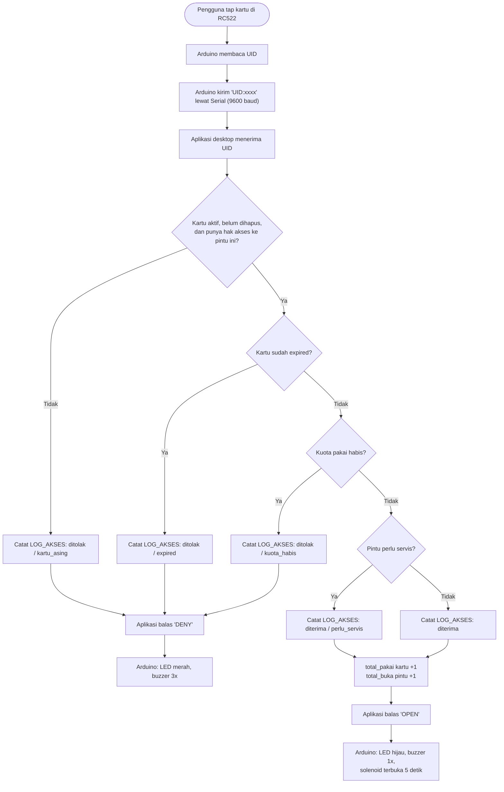
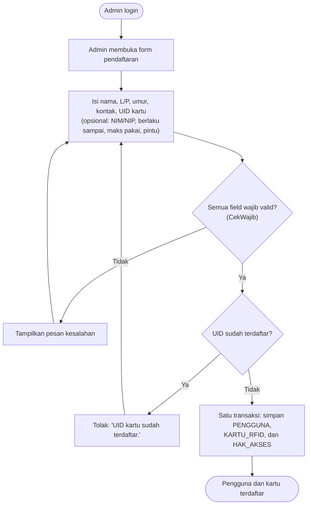

# Bisnis Proses Aplikasi — Smart Door Access (Pertemuan 3)

Sistem pintu pintar berbasis kartu RFID untuk Kelompok 4 (`CompanyCode = KEL4`). Dokumen ini menjelaskan siapa yang terlibat, proses apa yang berjalan, dan aturan bisnis yang dipakai. Isinya mengikuti kode di repo ini (`AuthService`, `SmartDoorDb`, `DaftarPengguna`) dan README firmware.

## 1. Aktor

| Aktor | Peran dalam proses |
|---|---|
| Pengguna | Pemegang kartu RFID; men-tap kartu untuk membuka pintu. |
| Admin | Login ke aplikasi desktop; mendaftarkan pengguna dan kartu, memantau data dan log, menandai servis pintu. |
| Arduino Uno + RC522 | Membaca UID kartu, mengirim `UID:xxxx` lewat Serial 9600 baud, menjalankan balasan `OPEN` atau `DENY` (LED, buzzer, relay/solenoid). |
| Aplikasi desktop (WPF) | Menerima UID, memanggil backend, membalas ke Arduino, menampilkan status dan layar admin. |
| Backend (`AuthService`, `SmartDoorDb`) | Memutuskan diterima atau ditolak, menulis log, menaikkan counter. |
| SQL Server | Menyimpan 6 tabel: ADMIN, PENGGUNA, PINTU, KARTU_RFID, HAK_AKSES, LOG_AKSES. |

## 2. Proses utama: akses pintu (tap kartu)

Catatan: kartu yang dikenal tetapi tidak punya hak akses ke pintu itu saat ini ikut tercatat sebagai `kartu_asing`, karena pencarian hak akses mengembalikan hasil kosong untuk kedua kasus.

## 3. Proses pendukung: pendaftaran pengguna dan kartu

## 4. Proses pendukung lain

- **Pemantauan.** Admin login lalu melihat daftar pengguna dan 100 log akses terakhir.
- **Servis pintu.** Sistem menghitung pintu yang butuh servis; admin menandai pintu sudah diservis, yang mengisi `servis_terakhir`.
- **Penonaktifan data.** Data tidak dihapus fisik; `Status` dan `IsDeleted` (Default Fields) dipakai untuk menandai data tidak aktif.

## 5. Aturan bisnis

| No | Aturan |
|---|---|
| 1 | Kartu hanya sah jika `Status = 1` dan `IsDeleted = 0`. Hal yang sama berlaku untuk hak akses dan pintu. |
| 2 | Kartu harus punya `HAK_AKSES` aktif ke pintu yang di-tap. |
| 3 | `berlaku_sampai` kosong berarti tanpa batas waktu; jika sudah lewat, tap ditolak dengan alasan `expired`. |
| 4 | `maks_pakai` kosong berarti tanpa kuota; jika `total_pakai >= maks_pakai`, tap ditolak dengan alasan `kuota_habis`. |
| 5 | Pintu perlu servis jika `total_buka >= batas_servis` atau sudah N hari (`servis_tiap_hari`) sejak `servis_terakhir`. Tap tetap diterima dan dicatat `perlu_servis` sebagai info admin. |
| 6 | Setiap tap, termasuk kartu asing, dicatat di `LOG_AKSES` (`id_kartu` kosong untuk kartu asing). |
| 7 | UID kartu unik per `CompanyCode`. |
| 8 | Pendaftaran wajib mengisi nama, jenis kelamin (`L`/`P`), umur (>= 0), kontak, dan UID. `berlaku_sampai` harus di masa depan dan `maks_pakai` tidak boleh negatif. |
| 9 | Login admin berhasil jika username ada, akun aktif, dan hash SHA-256 password cocok. |

## 6. Data yang disentuh tiap proses

| Proses | Membaca | Menulis |
|---|---|---|
| Akses pintu | KARTU_RFID, HAK_AKSES, PINTU | LOG_AKSES; counter di KARTU_RFID dan PINTU |
| Pendaftaran | KARTU_RFID (cek UID duplikat) | PENGGUNA, KARTU_RFID, HAK_AKSES |
| Pemantauan | PENGGUNA, LOG_AKSES | — |
| Servis pintu | PINTU | PINTU (`servis_terakhir`) |
| Login admin | ADMIN | — |

## 7. Status implementasi saat dokumen ini ditulis

| Proses | Backend | Aplikasi desktop | Firmware |
|---|---|---|---|
| Akses pintu | Ada | Belum membaca Serial (`serial.Start` masih TODO) | Belum di-commit |
| Pendaftaran | Ada (`DaftarkanPenggunaAsync`) | Form belum ada | — |
| Pemantauan | Ada | Ada (tabel pengguna dan log) | — |
| Servis pintu | Ada (`ReadStatusServisAsync`, `TandaiServisAsync`) | Belum ada layar | — |
| Penonaktifan data | Belum ada operasi Update/Delete | Belum ada | — |
