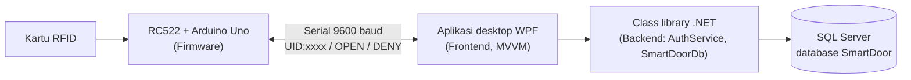

# Tools, Component & Framework — Smart Door Access (Pertemuan 5)

Dokumen ini mendaftar semua tools, komponen, dan framework yang dipakai, alasan pemilihannya, dan cara menyiapkan lingkungan kerja. Versi paket diambil dari file `.csproj` di repo Backend dan Frontend.

## 1. Arsitektur



Tiga repo terpisah di organisasi [Project-IOT-Smart-Door](https://github.com/Project-IOT-Smart-Door): `Smartdoor-Firmware`, `Smartdoor-Frontend` (aplikasi WPF), dan `Smartdoor-Backend` (class library + skrip database). Frontend mereferensikan proyek Backend langsung lewat `ProjectReference`.

## 2. Framework dan library

| Lapisan | Teknologi | Versi | Fungsi |
|---|---|---|---|
| Runtime | .NET | 10 (`net10.0`, `net10.0-windows`) | Platform untuk backend dan aplikasi desktop |
| Bahasa | C# | Bawaan .NET 10 | Bahasa seluruh aplikasi |
| UI | WPF | Bawaan .NET 10 (Windows) | Aplikasi desktop (layar User, Login, Admin, tema Terang/Gelap/Custom) |
| Pola UI | CommunityToolkit.Mvvm | 8.4.2 | `ObservableObject`, `[ObservableProperty]`, `[RelayCommand]` |
| Dependency injection | Microsoft.Extensions.DependencyInjection | 10.0.12 | Merangkai `SmartDoorDb`, `AuthService`, `SerialService`, `MainViewModel` |
| Akses data | Dapper | 2.1.89 | Query SQL ringan dengan pemetaan ke record C# |
| Driver database | Microsoft.Data.SqlClient | 7.1.1 | Koneksi ke SQL Server |
| Komunikasi serial | System.IO.Ports | 10.0.12 | Membaca `UID:xxxx` dan membalas `OPEN`/`DENY` ke Arduino |
| Solution | `.slnx` | — | Format solution XML Visual Studio terbaru |

## 3. Tools pengembangan

| Tool | Dipakai untuk |
|---|---|
| Visual Studio 2026 | Mengembangkan dan menjalankan solution Backend dan Frontend |
| SQL Server (LocalDB atau Express) | Database lokal `SmartDoor` |
| SQL Server Management Studio 22 | Mengelola database, menjalankan `schema.sql` dan `seed.sql`, memeriksa data |
| `sqlcmd` | Menjalankan skrip database dari terminal |
| Inno Setup | Membuat installer `SmartDoorSetup.exe` dari `installer/setup.iss` |
| Arduino IDE (atau PlatformIO) | Menulis dan meng-upload firmware ke Arduino Uno |
| Git dan GitHub | Version control; tiap anggota bekerja di branch sendiri lalu membuat Pull Request ke `main` |

Catatan: database awalnya dirancang dengan SQLite (DB Browser for SQLite) lalu dimigrasi ke SQL Server. Skema dan kode saat ini sepenuhnya SQL Server.

## 4. Komponen perangkat keras

| Komponen | Fungsi |
|---|---|
| Arduino Uno | Mikrokontroler utama |
| Modul RFID RC522 | Pembaca kartu; menghasilkan UID hex |
| Buzzer | Suara notifikasi (1x diterima, 3x ditolak) |
| LED merah dan hijau | Indikator ditolak dan diterima |
| Relay 1 channel | Pengendali solenoid |
| Solenoid door lock | Pengunci pintu (catu daya terpisah + dioda flyback) |

## 5. Menyiapkan lingkungan kerja

1. Pasang Visual Studio 2026 dengan workload **.NET desktop development**, dan SQL Server (LocalDB atau Express) beserta SSMS 22.
2. Clone **kedua repo berdampingan** dalam satu folder induk. Nama folder harus persis seperti ini karena path `ProjectReference` bersifat relatif:

   ```
   <folder-induk>/
   ├── Smartdoor-Backend/
   └── Smartdoor-Frontend/
   ```

3. Buat database dan isi data awal. Sesuaikan nama instance dengan yang tampil di SSMS 22 Anda:

   ```bash
   # SQL Server Express
   sqlcmd -S localhost\SQLEXPRESS -E -i database/schema.sql
   sqlcmd -S localhost\SQLEXPRESS -E -i database/seed.sql

   # LocalDB
   sqlcmd -S "(localdb)\MSSQLLocalDB" -E -i database/schema.sql
   sqlcmd -S "(localdb)\MSSQLLocalDB" -E -i database/seed.sql
   ```

   Akun awal dari `seed.sql`: username `admin`, password `admin123` (ganti sebelum dipakai sungguhan).
4. Samakan connection string di `App.xaml.cs` (Frontend) dengan instance Anda, misalnya `Server=localhost\SQLEXPRESS;Database=SmartDoor;Trusted_Connection=True;TrustServerCertificate=True`.
5. Bangun dan jalankan:

   ```bash
   dotnet build Smartdoor-Backend/SmartDoor.Backend.slnx
   dotnet run --project Smartdoor-Frontend/src/SmartDoor.App
   ```

6. Firmware: buka `smartdoor.ino` di Arduino IDE, pilih board *Arduino Uno*, lalu Upload.
